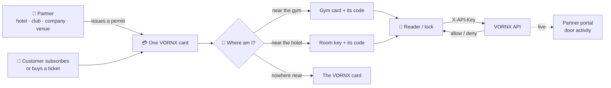
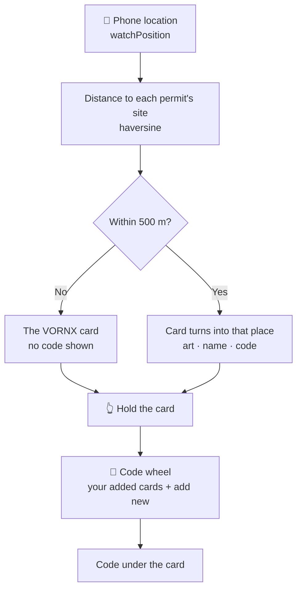
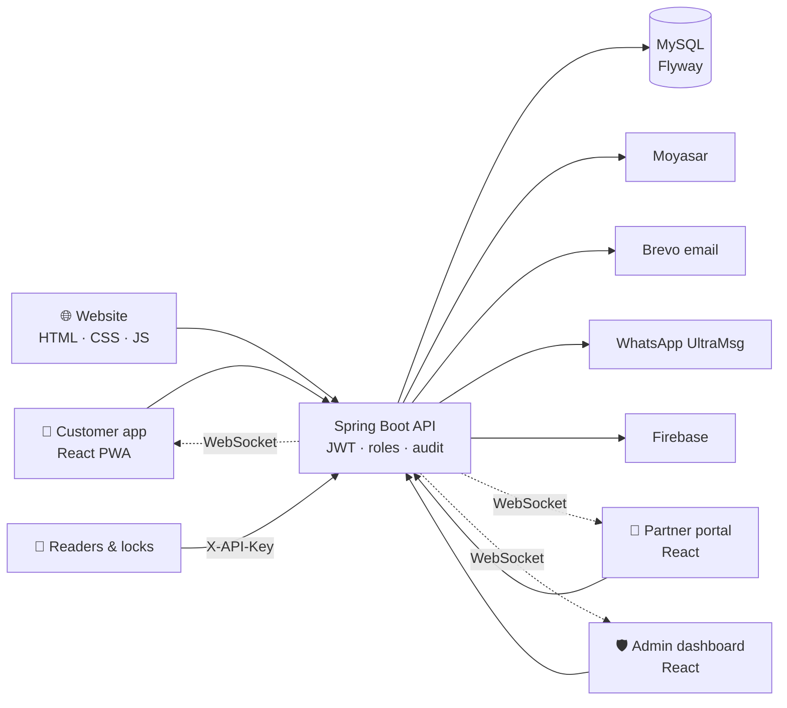
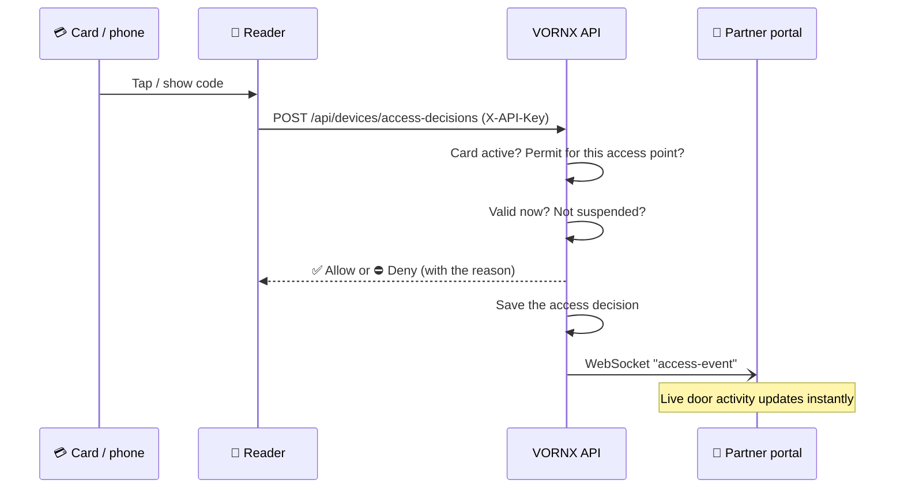
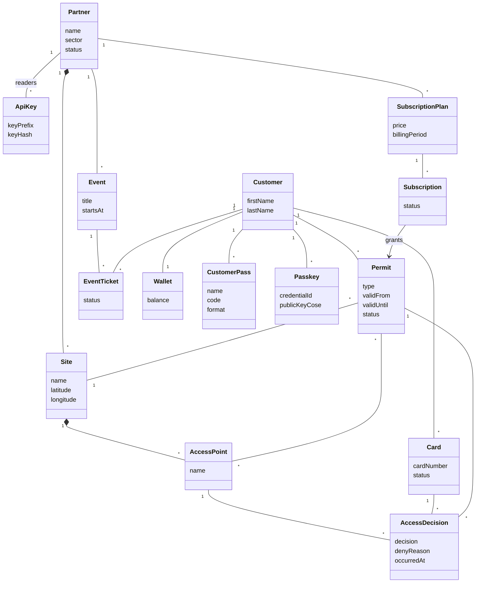

<div align="center">

<picture>
  <source media="(prefers-color-scheme: dark)" srcset="docs/brand/logo-light.png">
  
</picture>

# VORNX · فورنكس

**One card, connected access.**

### بطاقة واحدة.. لكل مكان

بطاقة واحدة تتحوّل إلى بطاقة المكان الأقرب لك: النادي، الفندق، العمل، الموقف، المترو، والفعاليات

<br>

<a href="https://website-service.up.railway.app"></a>
<a href="https://vornx-customer.up.railway.app"></a>
<a href="https://vornx-partner.up.railway.app"></a>

<br><br>


<br>


<br>


<br>

**159 endpoints · 39 controllers · 36 entities · 4 apps + a website · 117 tests**

</div>

---

> Your gym membership, your hotel room key, your office badge, your parking pass, your metro card and your event ticket
> usually live in six different cards and apps.
> **VORNX** puts them in **one card**. It isn't a wallet full of cards: you see **one card**, and it **adapts to where you are**.
> Walk into the gym and it becomes your gym card. Reach the hotel and it is your room key. The code under it changes with you.
>
> Hold the card and a **code wheel** opens, to choose any card you added yourself.

## 📑 Table of Contents

- [How It Works](#-how-it-works)
- [Features](#-features)
- [The Adaptive Card](#-the-adaptive-card)
- [Security](#-security)
- [Integrations](#-integrations)
- [Architecture](#%EF%B8%8F-architecture)
- [The Access Decision](#-the-access-decision)
- [Data Model](#%EF%B8%8F-data-model)
- [Project Structure](#-project-structure)
- [Getting Started](#-getting-started)
- [API Overview](#-api-overview)
- [Team](#-team)

## 🔁 How It Works



## ✨ Features

### 💳 Customer app (PWA)
- **One adaptive card**: it becomes the card of the nearest place (500 m), with that place's art and code.
- **Code wheel**: press and hold the card, slide to a card, lift to show its code. Smooth, with haptics.
- **Scan to add cards**: add your own loyalty and membership cards with the camera, a screenshot or by typing.
  Barcodes and QR codes are read **on the phone** (zxing-wasm).
- **Card skins**: choose the look of your VORNX card.
- **Permits**: hotel keys, workplace access, club memberships, parking, transit. Open the door from your phone.
- **Subscriptions and events**: browse plans, subscribe, buy tickets.
- **Wallet**: top up by card (mada, Visa, Mastercard, Apple Pay through Moyasar), transfer, pay from the balance.
- **Access log**, devices, lost-card report, **Arabic / English** with full RTL ↔ LTR.

### 🏨 Partner portal
- **Live door activity**: every tap on every reader, in real time.
- **Permits and digital keys**, subscription requests, sites and access points, plans, events and tickets.
- **Team roles**: `PARTNER_ADMIN`, `MANAGER`, `FRONT_DESK`, `VIEWER`. The UI and the API apply the same rules.
- Contract and invoices, device API keys, support, activity log.

### 🛡️ Admin dashboard
- **Partners**: applications from the website, approve or reject, contracts, invoices, account managers.
- **Customers**: search and view every customer, their cards and permits.
- **VORNX team**: invite colleagues by email, change roles, suspend. The last super admin is protected.
- Website messages, support, notifications, audit log.

### 🌐 Public website
- The landing page with a live **adaptive card demo**, the partner application form and the contact form.

## 📍 The Adaptive Card



- The location **never leaves the phone**. Distances are computed on the device.
- The code shows **only when it is needed**: near a place, or when you pick one from the wheel.
- Linear barcodes (Code 128, EAN...) and 2-D codes (QR, Aztec, PDF417) are drawn as sharp SVG.

## 🔐 Security

| Area | How |
|---|---|
| 🔑 **Sessions** | Short JWT access tokens + rotating refresh tokens; all tabs share one session through a Web Lock |
| 👤 **Face ID / fingerprint** | Passkeys (WebAuthn, Yubico): only the public key is stored, and it can't be phished |
| 📧 **Two-step login** | A 6-digit code by email or SMS (Firebase), or an authenticator app (TOTP, encrypted with AES-GCM) |
| 📲 **Phone verification** | A WhatsApp code at sign-up (UltraMsg) |
| 💰 **Payments** | The wallet is credited only after the server fetches the invoice from Moyasar with the secret key; a row lock credits once |
| 🚪 **Devices** | Readers and locks use their own `X-API-Key`, never a user token |
| 🧾 **Audit** | Every admin and partner action is logged |
| 🌐 **Frontends** | Strict Content-Security-Policy, Permissions-Policy, nginx security headers |
| 🧂 **Secrets** | One-time tokens and codes are stored as hashes only |

## 🔌 Integrations

| Service | Used for | How |
|---|---|---|
|  **Railway** | Hosting | The API, MySQL, three apps and the website, each a service from this repo |
| 💳 **Moyasar** | Wallet top-up by card | Hosted invoice page; card details never touch VORNX |
|  **Brevo** | Email | Transactional email through an outbox (verification, invites, receipts, security alerts) |
|  **UltraMsg (WhatsApp)** | Phone verification | A code sent by WhatsApp at sign-up |
|  **Firebase Phone Auth** | SMS login codes | The API checks the Firebase ID token's signature, project, age and phone |
| 🔐 **WebAuthn (Yubico)** | Face ID / Touch ID / Windows Hello | `webauthn-server-core` checks every registration and sign-in |
| 📷 **zxing-wasm** | Scanning and drawing barcodes | Runs on the phone, self-hosted, no data sent anywhere |

## 🏗️ Architecture



| Path | Who | Auth |
|---|---|---|
| `/api/public/**` | anyone (login, sign-up, password reset, website forms) | none |
| `/api/admin/**` | VORNX team | JWT, `TYPE_ADMIN` |
| `/api/partner/**` | partner staff | JWT, `TYPE_PARTNER_USER` |
| `/api/customer/**` | card holders | JWT, `TYPE_CUSTOMER` |
| `/api/devices/**` | readers and locks | `X-API-Key` |
| `/ws` | the three apps | access token in the first message |

## 🚪 The Access Decision



## 🗄️ Data Model

The core classes (out of 36 entities):



## 📁 Project Structure

```
Vornx
├── src/main/java/com/example/vornx
│   ├── access         # sites, access points, permits, the access decision engine
│   ├── security       # JWT, sessions, passwords, OTP, TOTP, passkeys, devices
│   ├── platform       # admins, team invites, customers view
│   ├── partner        # partners, applications, staff
│   ├── customer       # customers and cards
│   ├── pass           # cards the customer adds (scan to add)
│   ├── wallet         # balance, top-up, transfers
│   ├── payment        # Moyasar
│   ├── subscription   # plans and subscriptions
│   ├── events         # events and tickets
│   ├── billing        # contracts and invoices
│   ├── realtime       # WebSocket hub
│   ├── notification · audit · email · whatsapp · support · inquiry
│   └── demo           # demo data seeder
├── src/main/resources/db/migration   # Flyway V1..V17
├── frontend
│   ├── customer       # React PWA: the adaptive card, wheel, scanner, wallet
│   ├── partner        # React: partner portal
│   ├── admin          # React: admin dashboard
│   └── site           # public website (plain HTML/CSS/JS)
└── docs               # operations guide, brand
```

## 🚀 Getting Started

**Requirements:** Java 21, MySQL 8 / MariaDB (e.g. XAMPP), Node 20+.

### Backend

```bash
git clone https://github.com/gTurki/Vornx.git
cd Vornx
./mvnw spring-boot:run
```

Create the database `vornx_db` and an `src/main/resources/application-local.properties` (git-ignored):

```properties
spring.datasource.username=root
spring.datasource.password=
vornx.jwt.secret=<base64, at least 32 bytes>
vornx.bootstrap.admin-email=admin@vornx.sa
vornx.bootstrap.admin-password=<choose one>
vornx.mail.mode=preview
vornx.wallet.simulated-top-up-enabled=true
springdoc.api-docs.enabled=true
springdoc.swagger-ui.enabled=true
```

Flyway creates every table. Swagger UI: http://localhost:8080/swagger-ui.html

### Frontends

```bash
cd frontend/admin    && npm install && npm run dev   # http://localhost:5173
cd frontend/partner  && npm install && npm run dev   # http://localhost:5174
cd frontend/customer && npm install && npm run dev   # http://localhost:5175
```

The website (`frontend/site`) is plain HTML: open it with any static server.

### Tests

```bash
./mvnw test    # 117 tests
```

📘 **Deployment, environment variables, payments, login codes, passkeys and demo data:
[docs/OPERATIONS.md](docs/OPERATIONS.md)**

## 📊 API Overview

**159 endpoints across 39 controllers.** Swagger UI lists every one when `springdoc` is on (off in production).

| Portal | Main areas |
|---|---|
| 🌐 **Public** | Sign-up, login (password, code, passkey), password reset, partner applications, website inquiries, Moyasar callback |
| 💳 **Customer** | Card, permits (open the door), added cards, subscriptions, events and tickets, wallet, access log, security (TOTP, passkeys, devices) |
| 🏨 **Partner** | Overview, live activity, permits and keys, requests, sites and access points, plans, events, billing, team, device keys, support |
| 🛡️ **Admin** | Partners and applications, contracts and invoices, customers, VORNX team, inquiries, support, notifications, audit |
| 🚪 **Devices** | The access decision for readers and locks |

## 👥 Team

<table>
  <tr>
    <td align="center" width="50%" valign="top">
      <a href="https://github.com/gTurki"><br><b>Turki Alghamdi</b></a><br>
      <sub>👑 Founder</sub><br><sub>Backend & Frontend</sub><br><br>
      <sub>The idea, the API, security, payments, the access engine, the four apps and the website</sub>
    </td>
    <td align="center" width="50%" valign="top">
      <a href="https://github.com/raghada30"><br><b>Raghad Alaqeel</b></a><br>
      <sub>🎨 UI / UX Designer</sub><br><sub>Design & Brand</sub><br><br>
      <sub>The interface and user experience, the visual design, the colors and the look of VORNX</sub>
    </td>
  </tr>
</table>

---

<div align="center">


<sub><b>VORNX</b> · بطاقة واحدة.. لكل مكان</sub><br>
<sub>Made with ❤️ by Turki and Raghad</sub>

</div>
